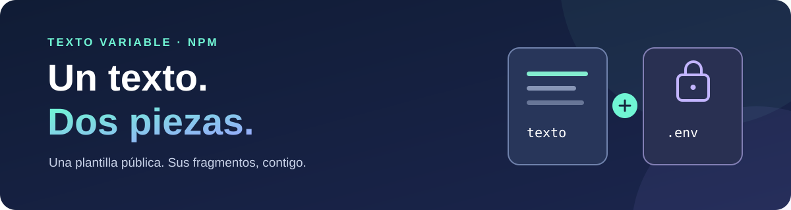

<p align="center">
  
</p>

<p align="center">
  <a href="https://www.npmjs.com/package/@karloxd1938/texto-variable"></a>
  
  
</p>

<p align="center">
  <strong>Un texto público con huecos. Dos fragmentos privados. Una función para volver a unirlos.</strong>
</p>

---

## La idea

A veces quieres compartir la estructura de un texto sin publicar todos sus datos. Este paquete separa la plantilla de sus fragmentos sensibles y permite reconstruirla localmente cuando tú decidas.

| Pieza | Qué contiene | Dónde vive |
| --- | --- | --- |
| `texto` | El texto con dos marcadores en lugar de los fragmentos privados. | En el paquete público. |
| `TEXTO_CABECERAS_BASE64` | El fragmento de las cabeceras, codificado. | En tu entorno o `.env` local. |
| `TEXTO_CUERPO_BASE64` | El fragmento del cuerpo, codificado. | En tu entorno o `.env` local. |
| `textoCompleto()` | Une la plantilla y los dos fragmentos y devuelve una cadena. | En el paquete público. |

> [!IMPORTANT]
> **Base64 no es cifrado.** Cualquiera que tenga los valores privados puede decodificarlos. No subas tu `.env`, cookies, tokens o datos personales a un repositorio público. El paquete y el texto que exporta no ejecutan la petición ni hacen conexiones de red.

## 🚀 Empieza aquí

### 1. Instala el paquete

```bash
npm install @karloxd1938/texto-variable
```

### 2. Usa la plantilla pública

```js
const { texto } = require('@karloxd1938/texto-variable');

console.log(texto); // Una cadena con marcadores; no contiene los fragmentos privados.
```

### 3. Reconstruye el texto cuando tengas los dos valores

Añade las dos variables a tu `.env` local. El archivo [`.env.example`](./.env.example) muestra sus nombres, pero no contiene datos reales:

```dotenv
TEXTO_CABECERAS_BASE64=tu_valor_privado
TEXTO_CUERPO_BASE64=tu_valor_privado
```

Después, en tu aplicación:

```js
const { textoCompleto } = require('@karloxd1938/texto-variable');

const completo = textoCompleto(); // Devuelve el texto original como cadena.
```

Con Node.js 20.12 o posterior puedes cargar el archivo así:

```bash
node --env-file=.env tu-programa.cjs
```

En Node.js 18, establece las variables de entorno por otro medio antes de arrancar el programa. Si falta una variable o no contiene Base64 válido, la función explica cuál debes revisar.

> [!NOTE]
> El paquete público no contiene los valores privados. La persona que necesite reconstruir el texto debe recibirlos por separado; con solo instalar el paquete puede usar la plantilla con marcadores.

## 🧩 Cómo encajan las piezas

```text
  PAQUETE PÚBLICO                  ENTORNO LOCAL
  ┌───────────────────┐           ┌──────────────────────┐
  │ texto con huecos  │           │ cabeceras en Base64  │
  │                   │           │ cuerpo en Base64     │
  └─────────┬─────────┘           └──────────┬───────────┘
            └──────────────┬─────────────────┘
                           ▼
                   textoCompleto()
                           │
                           ▼
                  cadena reconstruida
```

La función valida el formato Base64 y UTF-8, sustituye cada marcador y devuelve el resultado. **No evalúa el código, no hace `fetch` y no envía información a ningún sitio.**

## 📖 Referencia rápida

### `texto`

Cadena disponible inmediatamente al importar el paquete. Los fragmentos privados se representan como `[[CABECERAS_PRIVADAS]]` y `[[CUERPO_PRIVADO]]`.

### `textoCompleto(entorno = process.env)`

Devuelve la cadena reconstruida. Por defecto lee las variables del entorno; también puedes pasar un objeto explícito:

```js
const { textoCompleto } = require('@karloxd1938/texto-variable');

const ejemplo = textoCompleto({
  TEXTO_CABECERAS_BASE64: Buffer.from('{"ejemplo":"cabecera"}').toString('base64'),
  TEXTO_CUERPO_BASE64: Buffer.from('"cuerpo de ejemplo"').toString('base64'),
});
```

El objeto anterior es solo una demostración: sus valores no son las credenciales reales y el resultado contiene datos ficticios.

### ¿Usas módulos ES?

```js
import paquete from '@karloxd1938/texto-variable';

const { texto, textoCompleto } = paquete;
```

## 🛠️ Desarrollo y pruebas

Clona el repositorio y ejecuta las pruebas con Node.js; no necesitas instalar dependencias:

```bash
git clone https://github.com/Karlo1938/texto-variable.git
cd texto-variable
node test.cjs
```

Para comparar la reconstrucción con tu propio archivo original sin imprimir su contenido, proporciona también las variables privadas y la ruta al archivo:

```bash
node --env-file=.env test.cjs /ruta/a/tu/archivo-original.txt
```

El ejemplo local muestra solo la longitud de cada cadena, no los datos privados:

```bash
node --env-file=.env ejemplo.cjs
```

| Archivo | Función |
| --- | --- |
| `index.cjs` | Exporta la plantilla y la función de reconstrucción. |
| `texto.json` | Guarda la plantilla pública. |
| `ejemplo.cjs` | Enseña el uso local sin mostrar los datos sensibles. |
| `test.cjs` | Comprueba reconstrucción, Unicode y entradas inválidas. |
| `.env.example` | Documenta los nombres de las variables sin incluir valores. |

## 🔒 Antes de compartir o publicar

- Revisa que `.env`, `.npmrc-publicacion` y cualquier otro archivo de credenciales estén fuera de Git. El `.gitignore` de este proyecto los excluye.
- Comprueba qué incluiría npm con `npm pack --dry-run --ignore-scripts --offline`.
- La publicación de un paquete es pública. Aunque puedas retirarlo según la [política de npm](https://docs.npmjs.com/policies/unpublish/), las copias ya descargadas pueden seguir existiendo.

---

<p align="center">Hecho para que compartir una plantilla no signifique compartir sus secretos.</p>
